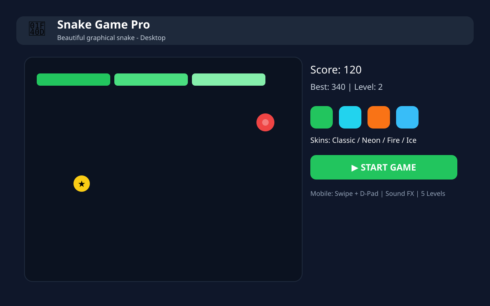
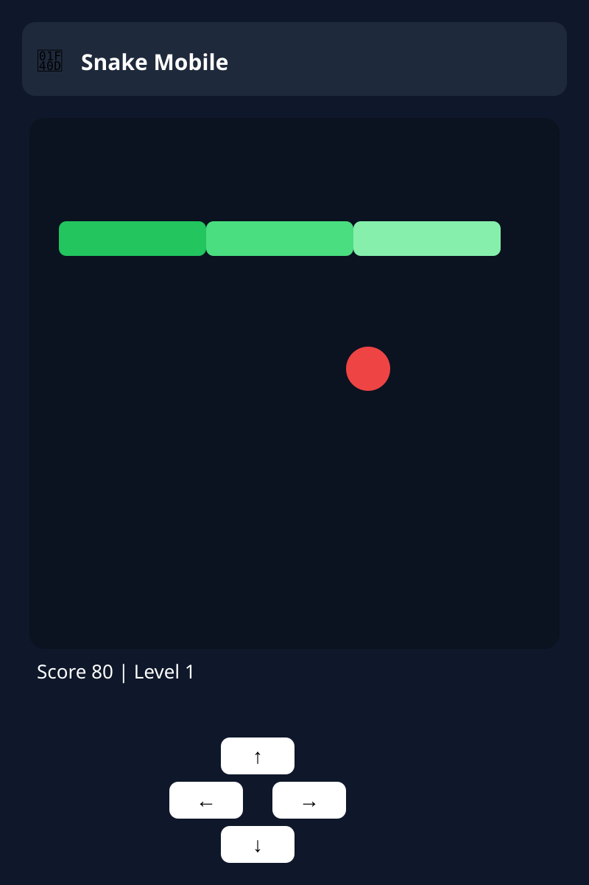

# 🐍 بازی مار پرو — Snake Game Pro

> یک بازی مار **گرافیکی، زیبا و کاملاً ریسپانسیو** با HTML / CSS / JavaScript خالص — بدون هیچ فریم‌ورک و بدون نیاز به نصب!
> ساخته شده برای دسکتاپ و موبایل (اندروید) با اسکین‌های متنوع، ۵ مرحله، ۴ درجه سختی و افکت‌های صوتی هیجان‌انگیز.

<p align="center">
  
</p>

<p align="center">
  
  <br>
  
</p>

---

## ✨ ویژگی‌ها

### 🎮 گیم‌پلی
- مار گرافیکی با سایه، درخشش (Glow) و چشم‌های متحرک
- غذای قرمز با افکت ضربان + **غذای طلایی 🌟 (+50 امتیاز)** که فقط ۶ ثانیه می‌ماند
- ذرات (Particles) هنگام خوردن غذا + لرزش صفحه هنگام باخت
- امتیاز، بهترین امتیاز (ذخیره در مرورگر)، تعداد سیب و شمارنده بازی
- نوار پیشرفت تا مرحله بعد

### 🎨 ۶ اسکین متنوع
| اسکین | توضیح |
|---|---|
| 🟢 کلاسیک سبز | سبز کلاسیک نوستالژیک |
| 💜 نئون | آبی-بنفش نئون با درخشش |
| 🔥 آتش | نارنجی-قرمز آتشین |
| ❄️ یخ | آبی یخی و سرد |
| 🌈 رنگین‌کمان | هر بخش مار یک رنگ! |
| ✨ کهکشان | بنفش-صورتی کهکشانی |

### 🗺️ ۵ مرحله
1. **چمن آرام** — بدون مانع، برای شروع
2. **دیوارهای پنهان** — موانع گوشه
3. **تونل وسط** — مانع مرکزی
4. **هزارتو** — موانع زیاد
5. **جهنم مار 🥵** — موانع + سرعت بالا

> هر ۵ سیب = رفتن به مرحله بعد به‌صورت خودکار + افزایش سرعت

### ⚡ ۴ درجه سختی
| سختی | سرعت | مناسب |
|---|---|---|
| آسان | کند | تازه‌کارها و بچه‌ها |
| متوسط | متوسط | همه |
| سخت | سریع | حرفه‌ای‌ها |
| دیوانه 🤯 | خیلی سریع | فقط افسانه‌ها! |

### 🔊 افکت‌های صوتی (بدون فایل خارجی!)
همه صداها با **Web Audio API** ساخته می‌شن، پس هیچ فایل صوتی لازم نیست:
- خوردن سیب 🍎
- غذای طلایی 🌟
- رفتن به مرحله بعد 🎉
- باخت 💀
- کلیک و چرخش

### 📱 کاملاً ریسپانسیو — مخصوص اندروید
- **سوایپ (کشیدن انگشت)** روی صفحه بازی
- **دکمه‌های جهت‌دار (D-Pad)** بزرگ و لمسی در موبایل
- جلوگیری از اسکرول صفحه هنگام بازی
- اندازه خودکار زمین بازی با سایز صفحه
- رابط کاربری راست‌چین و فارسی

### ⌨️ کنترل‌ها
| دسکتاپ | موبایل |
|---|---|
| کلیدهای جهت‌دار / WASD | سوایپ |
| Space = توقف / ادامه | دکمه‌های ⬆️⬇️⬅️➡️ |
| Enter = شروع | لمس دکمه شروع |

---

## 🚀 دستور اجرای ساده و سرراست

### روش ۱ — سریع‌ترین (فقط دوبار کلیک!)
1. همین ریپو رو دانلود کن (دکمه سبز **Code > Download ZIP**)
2. فایل ZIP رو باز کن
3. روی **`index.html`** دوبار کلیک کن — بازی باز می‌شه! 🎉

> هیچ نیازی به نصب Node، npm یا هیچ چیز دیگه‌ای نیست.

### روش ۲ — با VS Code (پیشنهادی برای توسعه)
```bash
# 1. کلون کردن
git clone https://github.com/NobodyknowKj/snake-game.git
cd snake-game

# 2. باز کردن در VS Code
code .

# 3. روی index.html راست‌کلیک کن > Open with Live Server
# یا از افزونه Live Server استفاده کن
```

### روش ۳ — با Python (سرور لوکال)
```bash
git clone https://github.com/NobodyknowKj/snake-game.git
cd snake-game

# Python 3
python3 -m http.server 8000

# بعد در مرورگر باز کن:
# http://localhost:8000
```

### روش ۴ — با Node.js
```bash
git clone https://github.com/NobodyknowKj/snake-game.git
cd snake-game
npx serve .
# یا
npx http-server -p 8000
```

### روش ۵ — روی موبایل اندروید 📱
1. فایل `index.html` رو با مرورگر Chrome موبایل باز کن
2. یا ریپو رو در GitHub Pages منتشر کن (پایین رو ببین)
3. یا با کابل USB فایل‌ها رو به گوشی منتقل کن و با Chrome باز کن

---

## 🌐 انتشار رایگان با GitHub Pages (لینک عمومی برای همه!)

1. برو به **Settings > Pages**
2. در بخش **Source** انتخاب کن: `Deploy from a branch`
3. Branch رو بذار روی `main` و پوشه `/ (root)`
4. Save رو بزن
5. بعد از ۱ دقیقه بازی با این لینک در دسترسه:

```
https://NobodyknowKj.github.io/snake-game/
```

---

## 📁 ساختار پروژه

```
snake-game/
├── index.html              # ساختار اصلی بازی + منوها (فارسی، RTL)
├── style.css               # استایل گرافیکی، ریسپانسیو، انیمیشن‌ها
├── script.js               # منطق کامل بازی، صدا، اسکین، مرحله، لمس
├── assets/
│   ├── screenshot-1.svg    # اسکرین‌شات دسکتاپ
│   ├── screenshot-2.svg    # اسکین‌ها و مراحل
│   └── screenshot-mobile.svg # نسخه موبایل
└── README.md               # همین فایل راهنما
```

---

## 🛠️ تکنولوژی‌ها

- **HTML5** — ساختار + Canvas برای رندر بازی
- **CSS3** — گرادیان، سایه، انیمیشن، Grid/Flex، Media Query موبایل
- **JavaScript (Vanilla)** — بدون هیچ کتابخانه خارجی
- **Web Audio API** — ساخت صدا به‌صورت کدنویسی
- **LocalStorage** — ذخیره بهترین امتیاز و آمار
- **Canvas 2D** — رندر مار، غذا، ذرات و موانع

---

## 🎯 چطور بازی کنیم؟ (قدم به قدم)

1. **اسکین** مورد علاقه‌ت رو انتخاب کن (مثلاً نئون 💜)
2. **درجه سختی** رو بذار روی آسان برای شروع
3. **مرحله** ۱ رو انتخاب کن
4. دکمه **▶️ شروع بازی** رو بزن
5. با جهت‌ها حرکت کن و سیب بخور
6. هر ۵ سیب = مرحله بعد!
7. غذای طلایی رو از دست نده — فقط ۶ ثانیه‌ست!
8. به خودت، موانع و (اگه فعال باشه) دیوار نزن!

---

## 💡 ایده‌های توسعه آینده

- [ ] حالت چندنفره (دو مار همزمان)
- [ ] اسکین‌های بیشتر + اسکین سفارشی
- [ ] جدول رکوردهای جهانی
- [ ] موسیقی پس‌زمینه
- [ ] حالت شب / روز
- [ ] ذخیره در ابر

اگه ایده‌ای داری، Issue باز کن یا Pull Request بده! 🤝

---

## 🤝 مشارکت

1. Fork کن
2. یک Branch جدید بساز: `git checkout -b feature/awesome`
3. تغییر بده و Commit کن: `git commit -m 'Add awesome feature'`
4. Push کن: `git push origin feature/awesome`
5. Pull Request باز کن

---

## 📄 لایسنس

این پروژه تحت لایسنس **MIT** منتشر شده — آزادانه استفاده، تغییر و انتشار بده.

---

## 👨‍💻 سازنده

ساخته شده با ❤️ توسط **Mehrshad** با کمک Muse

> ⭐ اگه این بازی رو دوست داشتی، به ریپو ستاره بده!
